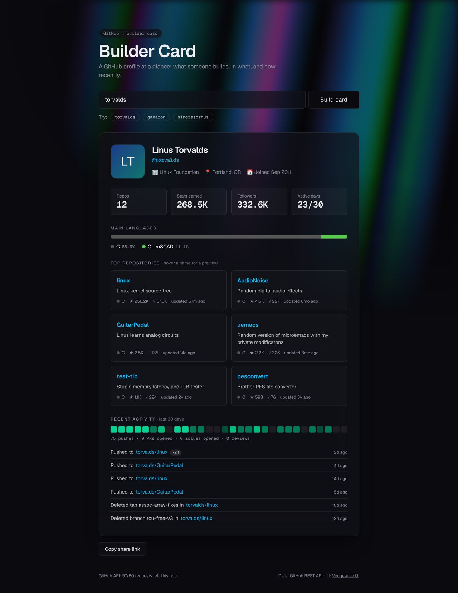

# 🛠️ Builder Card

Enter a GitHub username and get a **builder card**: who they are, their best repositories, the languages they build in, and what they've been doing over the last 30 days.

**🔗 Live:** https://builder-card-two.vercel.app
**👉 Try it:** [torvalds](https://builder-card-two.vercel.app/?u=torvalds) · [gaearon](https://builder-card-two.vercel.app/?u=gaearon) · [sindresorhus](https://builder-card-two.vercel.app/?u=sindresorhus) · [vercel (an org)](https://builder-card-two.vercel.app/?u=vercel) · [RounakKumarAgarwal (me)](https://builder-card-two.vercel.app/?u=RounakKumarAgarwal)



<sub>Screenshot uses real GitHub data; the avatar is replaced with a placeholder.</sub>

---

## What's on the card

| Section | How it's decided |
|---|---|
| **Profile** | Name, handle, bio, company, location, website, join date, plus repo / star / follower counts |
| **Top repositories** | Own repos only (forks show other people's work), ranked by **stars → forks → most recently pushed**. Hover a name to see GitHub's preview image. |
| **Main languages** | Each own repo's primary language, as a share of all their repos. Top 5 + "Other". |
| **Recent activity** | A 30-day heat strip, totals (pushes, PRs, issues, reviews) and the latest events in plain English. Back-to-back repeats are merged ("Pushed to torvalds/linux ×24"). |

Before you search, the page shows a short preview of what the card contains. Every card has a shareable URL: `/?u=username`.

## Stack

React 19 · Vite · Tailwind CSS v4 · Framer Motion · [Vengeance UI](https://www.vengenceui.com) · one Vercel serverless function. No backend database and no API keys in the browser.

## How it works

```
username ──► validate (no request if invalid)
         ──► GET /users/:name                      1 request; a typo stops here (404)
         ──► GET /users/:name/repos  (1–3 pages) ┐  in parallel
             GET /users/:name/events/public      ┘
         ──► analyze.js (pure functions) ──► React components
```

- **Profile first, alone.** A wrong username costs one request instead of three. The profile also tells us how many repo pages to fetch.
- **Repos and events in parallel** (`Promise.allSettled`). Repos are required; **events are optional**, so if they fail the card still renders with a note.
- **All logic is in plain JavaScript** (`src/lib/`). It has no React in it and is unit-tested. Components only display ready-made values.

### Project structure

```
src/
  lib/analyze.js       pure functions: ranking, languages, activity, event grouping
  lib/api.js           GitHub access: proxy/direct routing, typed errors, caching
  lib/utils.js         cn(), safeUrl(), number formatting, language colours
  hooks/useBuilder.js  username → { status, data, error }; cancels stale requests
  components/          SearchForm, IdleState, LoadingState, ErrorState
    card/              BuilderCard → ProfileHeader, StatGrid, LanguageBar, TopRepos, ActivityPanel
    ui/                Vengeance UI components (animated rays, button, cursor card, loader)
  App.jsx              URL sync (?u=) and which state to show
api/github.js          Vercel serverless proxy (validation, caching, optional token)
tests/                 node:test unit tests, no network needed
```

## Error handling

| Situation | What the user sees |
|---|---|
| Invalid username (`-abc`, spaces, >39 chars) | Caught **before** any request, with the username rules explained |
| User doesn't exist (404) | "User not found. Check the spelling?" |
| **Rate limit** (403/429 + `x-ratelimit-remaining: 0` or `Retry-After`) | The local time it resets, minutes remaining, and a **Try again** button |
| Network down | "Can't reach GitHub" + Try again |
| Activity request fails | Card still renders; the activity section explains |
| No repos / no activity / only forks | Friendly empty states; forks used as a fallback |
| Two searches in quick succession | The older request is aborted (`AbortController` in the effect cleanup), so a slow response can't overwrite the newer card |
| Organisation accounts | Supported, and labelled "Organization" |

### Staying under GitHub's rate limit

Unauthenticated GitHub API calls are limited to **60 per hour per IP**. A card costs 3–5 calls, so:

1. **Edge cache:** the Vercel function caches successful responses for 5 minutes, so repeat views of a popular card cost nothing. Errors are never cached.
2. **Browser cache:** `sessionStorage` with a 10-minute expiry, so reopening a card makes 0 requests.
3. **Visible quota:** the footer shows the requests left this hour.
4. **Optional token:** setting `GITHUB_TOKEN` on Vercel raises the limit to 5,000/hour. The token stays server-side and never reaches the browser.
5. **Fallback:** if the proxy isn't there (e.g. `npm run dev` or another host), the app calls GitHub directly.

### Security

- React escapes all text, so a bio like `<script>…</script>` renders as text. `dangerouslySetInnerHTML` is never used.
- Links aren't protocol-checked by React, so the website field goes through `safeUrl()`, which allows only `http(s)` and blocks `javascript:`.
- The proxy is **not an open proxy**: it accepts only 3 whitelisted endpoints, a validated username and a page number from 1 to 10.

## Testing

- **15 unit tests** (`npm test`) cover ranking, language stats, activity bucketing, event grouping, username validation, and the proxy (with `fetch` stubbed).
- **Real accounts** were checked end to end: torvalds, gaearon, sindresorhus (1,149 repos), vercel (an org), a non-existent user, and a small personal account. This found two real-world issues, both now fixed and tested: GitHub's events feed isn't always in time order, and busy accounts produce long runs of identical events.
- **Browser checks** covered the 404, rate-limit and invalid-input states, XSS payloads in bio/name, rapid double searches, deep links and the mobile layout.

## Trade-offs & what I'd do next

- **Languages count repos, not bytes.** Byte counts need one extra request per repo, which would burn the rate limit.
- **Up to 300 repos are ranked.** The REST API can't sort by stars, so for very large accounts the card ranks the 300 most recently updated repos, and says so.
- **Public activity only**, covering at most the last 90 days.
- **GitHub removed commit counts from push events** in 2025, so the app counts pushes.
- **Next step:** move to the **GraphQL API**. One request can return repos sorted by stars, language byte counts and the contribution calendar, which fixes the first three points.

## Run locally

```bash
npm install
npm run dev      # http://localhost:5173 (calls GitHub directly)
npm test         # 15 unit tests (Node 22+)
npm run lint
npm run build
```

## Deploy (Vercel)

1. Import the repo on vercel.com. Vite is auto-detected, and `api/github.js` becomes a serverless function.
2. *(Optional)* Add a fine-grained GitHub token (public read-only) as `GITHUB_TOKEN`, then redeploy.

## Credits

UI components from [Vengeance UI](https://github.com/Ashutoshx7/VengenceUI) (MIT licence), converted from TSX to JSX. Small changes are noted at the top of each file.

## Time taken

~X hours.
